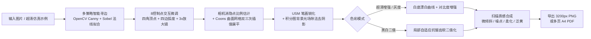

<div align="center">

# 📄 ScanLite Pro · 超清图片转扫描件工作台

**纯前端、零上传、300 DPI 印刷级清晰度的文档扫描与曲面展平工具**  
*A privacy-first, pure client-side document scanner & curved-page dewarping workbench in a single HTML file.*

[](https://opensource.org/licenses/MIT)
[](#)
[](#)
[](#)

</div>

---

## 📌 项目简介（Repository Description）

> **GitHub 仓库简介（About / Description）可直接复制下方内容：**
>
> **中文简介：**  
> `📄 ScanLite Pro：单文件即开即用的纯前端超清文档扫描工作台。集成 8 控制点 Coons 曲面展平（矫正书页弯曲与透视畸变）、双三次卷积插值、USM 笔画锐化、积分图去阴影与物理扫描仪质感模拟，100% 浏览器本地处理，支持导出 300 DPI 超清 PNG 与多页 A4 PDF。`
>
> **English Summary:**  
> `📄 ScanLite Pro: Zero-backend, single-file document scanner & curved-page dewarper. Features 8-point Coons patch dewarping, Bicubic interpolation, USM text sharpening, integral-image shadow removal, and realistic scan simulation. 100% local in-browser processing with 300 DPI PNG & multi-page PDF export.`
>
> **推荐 Topics 标签：**  
> `document-scanner` `perspective-correction` `dewarping` `image-processing` `opencv-js` `look-scanned` `pdf-generator` `canvas-2d` `privacy-first` `single-file-app`

---

## ✨ 核心特性（Key Features）

### 1. 📐 8 控制点曲面展平与真实比例还原（Stage A1: Geometry & Dewarping）
- **8 控制点双二次 Coons 曲面映射（Coons Patch）**：不仅提供 **4 个角点（蓝色圆点）** 消除梯形透视畸变，还独创支持 **4 个边中点弧度控制柄（翠绿色方块）**，轻松拉直拍摄书本时的**书脊隆起、纸张卷曲与手机广角桶形畸变**。
- **双引擎智能寻边**：结合 OpenCV.js 多阈值 Canny 凸四边形拟合与纯 JS 边缘色差/Sobel 法线梯度搜索，导入图片自动吸附纸张四角与弧边。
- **相机正交消隐点比例还原**：基于透视消隐点正交约束自动推算纸张倾斜前的**真实物理长宽比**，杜绝拉平后文字变扁或变长。
- **3× 局部十字放大镜 & 4×4 曲面对齐网格**：拖拽控制点时自动弹出 3 倍高清十字准星放大镜，配合画布内实时曲面网格线，毫厘级精准对齐文字行。

### 2. 🔍 300 DPI 超清重采样与去阴影增强（Stage A2: Clarity & Illumination）
- **Catmull-Rom 4×4 双三次卷积插值（Bicubic Interpolation）**：彻底解决传统双线性插值导致的小字发虚、斜线锯齿问题。
- **USM 非锐化掩模（Unsharp Mask）文字锐化**：提取高频笔画边缘并自适应增益，哪怕是 `8pt` 微缩文字与数学公式也能清晰锐利。
- **$O(N)$ 积分图光场归一化去阴影**：实时估算大窗口局部背景光强 $B(x,y)$，一键消除手指遮挡影、台灯渐变光与纸底灰雾，同时完整保留红色印章与批注色彩。
- **抗锯齿局部自适应软二值化**：在黑白复印模式下，基于局部均值动态计算软过渡阈值，黑字扎实饱满且边缘平滑无毛刺。

### 3. 🖨️ 物理扫描仪质感模拟（Stage B: Realistic Scanner Simulation）
- 既能将**手机拍照文档**还原为干净白底黑字，也能将**电子版截图/文稿**逆向制作为逼真的物理扫描件（参考 `lookscanned.io`）：
  - **微倾斜角度（$\pm 3^\circ$）**：模拟纸张放入扫描仪时的轻微歪斜；
  - **传感器颗粒噪点 & 光学柔化**：模拟 CIS/CCD 扫描头光学特征；
  - **陈旧纸张泛黄 & 归档压缩率调节**：支持三档 JPEG 压缩质量控制。

### 4. 🛡️ 纯本地隐私安全与批处理工作流
- **零服务器上传**：所有计算 100% 在本地浏览器内存中完成，机密合同、证件、财务票据绝不触网。
- **内置超清弯曲示例生成**：无需准备测试图，点击 **「加载超清示例」** 即可一键生成带深色桌面、梯形透视、上下边弯曲、台灯阴影与红章的 `1500×1950` 仿真拍照文档。
- **多页管理与一键批处理**：支持多图拖拽导入、页面上下排序、单页独立参数调节、**「同步全部页」** 一键批处理，以及 **1:1 原始像素放大验字** 与 **按住对比原图**。

---

## 🚀 快速开始（Quick Start）

### 方式一：双击即用（零安装）
本项目采用**单文件零构建架构**，克隆或下载仓库后，直接用任意现代浏览器（Edge / Chrome / Firefox / Safari）双击打开 [`index.html`](./index.html) 即可使用：

```bash
git clone https://github.com/lidahai4445/ScanLite.git
cd ScanLite
# Windows 直接打开
start index.html
```

### 方式二：使用桌面快捷方式
在 Windows 系统下，可将仓库内的 `ScanLite.ico` 绑定至快捷方式，直接从桌面一键启动。

---

## 🔬 算法流水线（Processing Pipeline）



---

## 📂 目录结构（Directory Structure）

```text
ScanLite/
├── index.html      # ScanLite Pro 完整单文件应用程序（UI + 视觉算法引擎）
├── 设计方案.md      # 算法原理、数学公式推导与技术架构设计文档
├── ScanLite.ico    # 多图层高清桌面图标（256x256 & 64x64）
└── README.md       # 项目说明文档与中英文简介
```

---

## 📄 开源协议（License）

本项目基于 [MIT License](https://opensource.org/licenses/MIT) 开源，欢迎自由使用、修改与分享。
