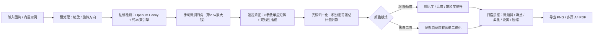

# 图片转扫描版文档 · 设计方案与实现说明

## 一、需求拆解

| 场景 | 输入 | 目标 | 代表产品 / 开源项目 |
|---|---|---|---|
| A. 拍照 → 扫描件 | 手机拍的纸张照片（有透视、阴影、背景） | 自动寻边、铺平、去阴影、白底黑字 | 扫描全能王（CamScanner）、Office Lens、jscanify |
| B. 电子件 → 仿扫描 | 截图 / 电子版图片 / 文档 | 看起来像物理扫描仪扫出来的（微倾斜、噪点、泛黄、压缩） | lookscanned.io、look-like-scanned、Falsisign |

本方案将两个场景合并为一条完整流水线：**先做“边缘检测、透视矫正与光照增强”（阶段 A），再按需叠加“物理扫描仪质感”（阶段 B）**。

---

## 二、开源资源参考

| 资源 | 语言 / 形态 | 可借鉴点 |
|---|---|---|
| [ColonelParrot/jscanify](https://github.com/ColonelParrot/jscanify) | JS + OpenCV.js | 浏览器端纸张边缘检测与透视提取 `extractPaper()` |
| PyImageSearch《4 Point OpenCV getPerspectiveTransform》 | Python + OpenCV | 经典四点透视矫正：`getPerspectiveTransform` + `warpPerspective` |
| [rwv/lookscanned.io](https://github.com/rwv/lookscanned.io) | Vue，纯前端 | 本地处理、旋转 + 噪点 + 模糊 + 灰度，导出 PDF |
| [navchandar/look-like-scanned](https://github.com/navchandar/look-like-scanned) | Python CLI | 随机倾斜、亮度/对比度调整、批量合并 PDF |
| OpenCV `adaptiveThreshold` | C++/Python/JS | 局部自适应二值化，解决光照不均 |
| DewarpNet / DocTr（学术开源） | PyTorch | 卷曲、褶皱纸张的深度学习展平（进阶） |
| jsPDF / img2pdf | JS / Python | 多页图片合成为标准 A4 PDF |

---

## 三、处理流水线

### 关键算法实现细节

1. **自动边缘检测（双引擎）**：
   - **OpenCV.js 引擎**：灰度化 → `GaussianBlur(5×5)` → `Canny(60, 180)` → 膨胀闭合 → `findContours` → `approxPolyDP` 拟合凸四边形，选取面积最大的纸张轮廓并按 `[左上, 右上, 右下, 左下]` 顺时针排序。
   - **纯 JS 离线引擎**：下采样后统计四周桌面背景亮度与中心纸面对比度，自适应阈值分割前景纸张，利用 $(x+y)$ 与 $(x-y)$ 极值快速提取四个顶点。
2. **透视矫正**：由 4 组对应点列 8 元线性方程组，使用高斯列主元消元法求解 $3\times3$ 单应矩阵 $H$，对输出平面每个像素逆向映射回原图并进行双线性插值：

$$
\begin{bmatrix}x'\\y'\\w\end{bmatrix}=H\begin{bmatrix}u\\v\\1\end{bmatrix},\quad (x,y)=\left(\frac{x'}{w},\frac{y'}{w}\right)
$$

   输出宽高默认取四边形对边最大长度，支持强制 **A4 纵向**（$1:\sqrt{2}$）或 **A4 横向**（$\sqrt{2}:1$）。
3. **光照 / 阴影去除**：用积分图（Integral Image）在 $O(N)$ 时间内完成大窗口均值滤波，估计局部背景光场 $B(x,y)$，令 $I' = I \times 246 / B$，将不均匀阴影拉平为均匀白底。
4. **自适应二值化**：像素灰度 $< B(x,y) \times (1 - T)$ 判为黑字，在阈值附近做连续软过渡以消除文字边缘锯齿。
5. **物理扫描质感**：$\pm 3^\circ$ 微旋转（底色自动填充纸张泛黄色）、传感器随机噪点、$0.1\sim 1.5\text{ px}$ 光学柔化、乘性纸张泛黄，以及导出 PDF 时的三档 JPEG 压缩率控制。

---

## 四、软件架构与已实现功能清单（`index.html`）

| 模块 | 已完成功能 |
|---|---|
| **界面与布局** | 浅色（Light Theme）三栏工作台：左侧页面管理、中间“原图裁切 + 实时预览”双画布、右侧参数面板 |
| **图片导入与示例** | 拖拽/多选导入本地图片；内置**“加载示例文档”**生成器（一键合成带深色桌面、梯形透视畸变、台灯阴影与红色印章的仿真拍照文稿） |
| **自动与手动裁切** | 导入时自动识别纸张四角；支持一键重新自动寻边、拖拽角点时自动弹出 **2.5× 局部十字放大镜**、顺时针旋转 90°、重置边角 |
| **多页管理与批处理** | 多页缩略图列表、页面上移/下移排序、单页删除、每页独立保存参数、**“同步到全部页”**一键批处理 |
| **增强与扫描模拟** | 4 种预设（清晰文档 / 黑白复印 / 真实扫描仪 / 仅透视裁切）、4 种色彩模式、8 项实时滑块、**“按住对比”**原图与扫描效果 |
| **导出能力** | 高分辨率单页 PNG 导出、多页 A4 PDF 自动纵横排版与三档 JPEG 压缩导出 |
